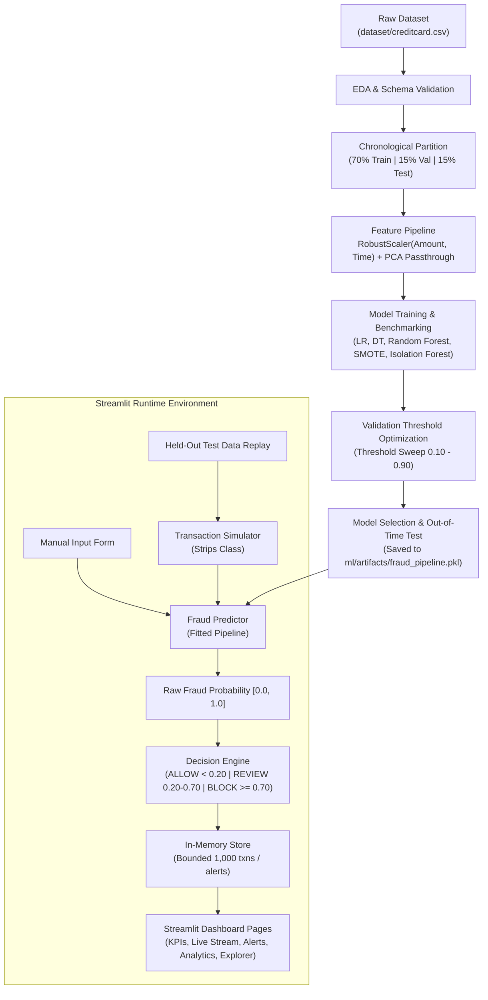
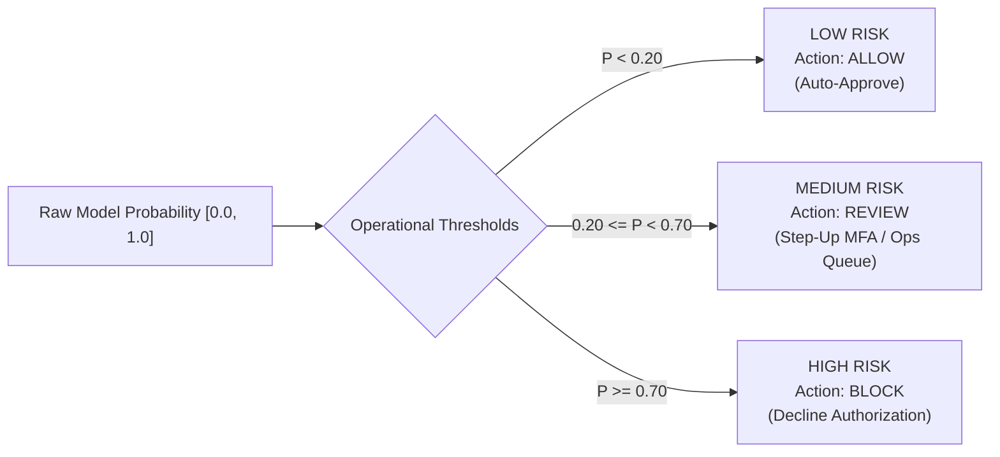

# 🛡️ Real-Time Credit Card Fraud Detection System

[](https://www.python.org/downloads/)
[](https://streamlit.io/)
[](https://scikit-learn.org/)
[](LICENSE)
[](tests/)

An end-to-end, production-grade Machine Learning and Streamlit application for detecting fraudulent credit card transactions in real-time. Built with rigorous class-imbalance handling, chronological data partitioning (zero data leakage), Bayesian decision threshold optimization, a configurable risk decision engine, an in-memory streaming replay engine, and automated unit testing.

---

## 📑 Table of Contents

1. [Project Overview](#1-project-overview)
2. [Problem Statement & Business Use Case](#2-problem-statement--business-use-case)
3. [Objectives](#3-objectives)
4. [Dataset Source & Characteristics](#4-dataset-source--characteristics)
5. [Technology Stack](#5-technology-stack)
6. [System Architecture](#6-system-architecture)
7. [Machine Learning Algorithms Evaluated](#7-machine-learning-algorithms-evaluated)
8. [Data Preprocessing & Leakage Prevention](#8-data-preprocessing--leakage-prevention)
9. [Class Imbalance: Cost-Sensitive Weights vs SMOTE](#9-class-imbalance-cost-sensitive-weights-vs-smote)
10. [Chronological Train-Validation-Test Strategy](#10-chronological-train-validation-test-strategy)
11. [Evaluation Metrics: Why Accuracy is Deceptive](#11-evaluation-metrics-why-accuracy-is-deceptive)
12. [Threshold Optimization & Decision Boundary Selection](#12-threshold-optimization--decision-boundary-selection)
13. [Actual Model Evaluation Results](#13-actual-model-evaluation-results)
14. [Fraud Decision Engine & Risk Band Architecture](#14-fraud-decision-engine--risk-band-architecture)
15. [Streamlit Application Walkthrough](#15-streamlit-application-walkthrough)
16. [Held-Out Transaction Simulator](#16-held-out-transaction-simulator)
17. [In-Memory Storage Buffer](#17-in-memory-storage-buffer)
18. [Project Structure](#18-project-structure)
19. [Installation & Setup](#19-installation--setup)
20. [Model Training Instructions](#20-model-training-instructions)
21. [Running the Application](#21-running-the-application)
22. [Running Automated Tests](#22-running-automated-tests)
23. [Deployment Guide (Streamlit Community Cloud)](#23-deployment-guide)
24. [Limitations](#24-limitations)
25. [Future Roadmap](#25-future-roadmap)

---

## 1. Project Overview

Credit card fraud costs financial institutions and consumers billions of dollars annually. While legitimate transactions make up over **99.8%** of payment volume, fraudulent events are rare, dynamic, and financially catastrophic.

This project delivers a **complete, portfolio-quality transaction monitoring and fraud detection platform**. Rather than a static mock UI, the system encompasses the entire lifecycle:
- Automated data validation and chronological partitioning
- Feature transformation pipelines (`RobustScaler` for outlier-heavy amounts)
- Supervised benchmarks (**Logistic Regression**, **Decision Trees**, **Random Forest**, **SMOTE + Random Forest**)
- Unsupervised anomaly detection experiment (**Isolation Forest**)
- Decision threshold optimization tuning
- In-memory circular buffer with duplicate prevention
- Real-time simulation replay from unseen test partitions
- Multi-tier alert queue and case review disposition

---

## 2. Problem Statement & Business Use Case

### The Problem
Fraud detection involves severe class imbalance (~0.17% fraud). In standard classification, naive models predicting "all transactions are legitimate" achieve 99.83% accuracy while failing 100% of fraud victims. Additionally, standard random cross-validation leaks future transaction patterns into past evaluations.

### The Business Tradeoff
- **False Negatives (Missed Fraud):** Direct chargebacks, financial liability, merchant penalties, and loss of customer trust.
- **False Positives (False Alarms):** Legitimate customer transactions blocked at checkout, cart abandonment, and customer dissatisfaction.
- **Operational Reality:** Banks cannot afford to manually review 100% of transactions. The system must partition decisions into:
  - **ALLOW:** Auto-approved (< 0.20 probability).
  - **REVIEW:** Flagged for step-up multi-factor authentication (MFA) or human analyst queue (0.20 – 0.70 probability).
  - **BLOCK:** Immediate automated decline (≥ 0.70 probability).

---

## 3. Objectives

- [x] Preprocess and scale heavy-tailed transaction amounts and elapsed time.
- [x] Enforce forward chronological splitting (zero lookahead bias).
- [x] Train multiple candidate algorithms and optimize classification thresholds on validation data.
- [x] Export fitted pipelines (`fraud_pipeline.pkl`) and metadata JSON artifacts.
- [x] Build a 6-page interactive Streamlit dashboard.
- [x] Stream held-out test transactions sequentially without leaking the ground-truth target `Class`.
- [x] Manage in-memory transaction history and fraud alerts with review actions.
- [x] Maintain automated unit test coverage across all components with Pytest.

---

## 4. Dataset Source & Characteristics

- **Source:** [ULB Machine Learning Group Credit Card Fraud Detection (Kaggle)](https://www.kaggle.com/datasets/mlg-ulb/creditcardfraud)
- **Transactions:** 284,807 transactions recorded across 48 hours (September 2013 by European cardholders).
- **Legitimate Transactions:** 284,315 (99.8273%)
- **Fraudulent Transactions:** 492 (0.1727%)
- **Columns (31 total):**
  - `Time`: Elapsed seconds from the initial transaction in the dataset (0 to 172,792 seconds).
  - `V1` to `V28`: 28 numerical features obtained via Principal Component Analysis (PCA) to preserve cardholder privacy.
  - `Amount`: Transaction amount in USD / EUR (ranges from $0.00 to $25,691.16, with heavy positive skew).
  - `Class`: Binary ground truth (0 for legitimate, 1 for fraudulent). Used strictly during training/evaluation and never passed into inference pipelines.

---

## 5. Technology Stack

- **Language:** Python 3.11+
- **Machine Learning & Core Data:** Scikit-learn, Imbalanced-learn, Pandas, NumPy, Joblib
- **Visualization:** Plotly, Matplotlib, Seaborn
- **Application Framework:** Streamlit (Session State, Resource & Data Caching)
- **Testing:** Pytest
- **Storage Strategy:** In-memory circular buffer (`deque`), Streamlit session state, file-based JSON/Pickle artifacts (No external DB dependencies).

---

## 6. System Architecture



---

## 7. Machine Learning Algorithms Evaluated

| Algorithm | Role & Rationale | Imbalance Strategy |
| :--- | :--- | :--- |
| **Logistic Regression** | Linear baseline, fast inference, well-calibrated probabilities. | `class_weight='balanced'` |
| **Decision Tree** | Interpretable tree, inspects orthogonal splits across PCA components. | `class_weight='balanced'`, `max_depth=6` |
| **Random Forest** | **Primary champion:** Non-linear ensemble, captures multi-feature PCA interactions, robust to noise. | `class_weight='balanced_subsample'`, `n_estimators=100`, `max_depth=12` |
| **Random Forest + SMOTE** | Synthetic oversampling of minority fraud instances in feature space. | `SMOTE(sampling_strategy=0.1)` applied strictly to `X_train` |
| **Isolation Forest** | Unsupervised anomaly baseline; fits purely on nominal behavior without labels. | `contamination=0.002` |

---

## 8. Data Preprocessing & Leakage Prevention

1. **Target Isolation:** The target column `Class` is strictly separated before transformation. `validate_inference_features()` strips `Class` if accidentally present.
2. **Amount & Time Scaling:** Because transaction amounts exhibit extreme outliers (max $25,691 vs median $22), `RobustScaler` scales median and interquartile range (IQR).
3. **PCA Passthrough:** Components `V1` to `V28` are already centered and orthogonal; they pass through untouched.
4. **Leakage Boundary:** Scalers are fitted **only** on the chronological training split `X_train`. Validation and test splits are strictly transformed using the parameters learned from `X_train`.

---

## 9. Class Imbalance: Cost-Sensitive Weights vs SMOTE

- **Cost-Sensitive Weighting (`balanced_subsample`):** Weights inversely proportional to class frequencies calculated per tree bootstrap sample. This dynamically penalizes false negatives without creating synthetic artifacts.
- **SMOTE (Synthetic Minority Over-sampling Technique):** Synthesizes artificial fraud points along k-nearest neighbor vectors in the PCA space. Fitted solely inside an `imblearn.pipeline.Pipeline` on training data.
- **Empirical Finding:** Random Forest with `balanced_subsample` achieved higher validation PR-AUC (**0.8669**) than SMOTE + Random Forest (**0.8619**), while training faster and avoiding synthetic sample artifacts near decision boundaries.

---

## 10. Chronological Train-Validation-Test Strategy

Standard random k-fold cross-validation is **invalid** for fraud detection because it permits future fraud transactions to train models predicting past events.

This system sorts by `Time` and establishes three strict temporal partitions:

| Partition | Share | Elapsed Time Window | Total Rows | Fraud Count | Fraud % |
| :--- | :--- | :--- | :--- | :--- | :--- |
| **Training Set** | 70% | 0.0s – 120,418.0s (~33.4 hrs) | 199,364 | 384 | 0.193% |
| **Validation Set** | 15% | 120,418.0s – 144,382.0s (~6.7 hrs) | 42,721 | 56 | 0.131% |
| **Out-of-Time Test Set** | 15% | 144,382.0s – 172,792.0s (~7.9 hrs) | 42,722 | 52 | 0.122% |

---

## 11. Evaluation Metrics: Why Accuracy is Deceptive

On a dataset where **99.83%** of instances are legitimate:
$$\text{Accuracy of Dummy Predictor} = \frac{284,315}{284,807} = 99.827\%$$
A trivial model predicting zero fraud catches 0% of attacks while boasting 99.8% accuracy.

Therefore, our primary evaluation metrics are:
- **Precision-Recall AUC (PR-AUC / Average Precision):** Evaluates precision against recall across all thresholds without being influenced by large true-negative counts.
- **Recall (Sensitivity):** $\frac{\text{True Positives}}{\text{True Positives} + \text{False Negatives}}$ (The percentage of actual fraud caught).
- **Precision:** $\frac{\text{True Positives}}{\text{True Positives} + \text{False Positives}}$ (The reliability of fraud flags).
- **F1-Score:** Harmonic mean of precision and recall.

---

## 12. Threshold Optimization & Decision Boundary Selection

Rather than defaulting to an arbitrary 0.50 threshold, we swept classification thresholds from **0.10 to 0.90** on the validation partition:

| Threshold | Validation Precision | Validation Recall | Validation F1 | False Positives | False Negatives |
| :---: | :---: | :---: | :---: | :---: | :---: |
| 0.10 | 0.6125 | 0.8750 | 0.7206 | 31 | 7 |
| 0.20 | 0.7937 | 0.8929 | 0.8403 | 13 | 6 |
| 0.30 | 0.9348 | 0.7679 | 0.8431 | 3 | 13 |
| **0.40 (Optimal)** | **1.0000** | **0.7679** | **0.8687** | **0** | **13** |
| 0.50 | 1.0000 | 0.7321 | 0.8454 | 0 | 15 |
| 0.60 | 1.0000 | 0.7143 | 0.8333 | 0 | 16 |
| 0.70 | 1.0000 | 0.6786 | 0.8085 | 0 | 18 |

**Outcome:** A threshold of **0.40** maximized validation F1-score (**0.8687**) with zero false positives.

---

## 13. Actual Model Evaluation Results

### Validation Benchmark Comparison (42,721 records, 56 fraud events)

| Model | Val PR-AUC | Val ROC-AUC | Optimal Thresh | Val Recall | Val Precision | Val F1 |
| :--- | :---: | :---: | :---: | :---: | :---: | :---: |
| 🏆 **Random Forest** | **0.8669** | **0.9778** | **0.40** | **76.79%** | **100.00%** | **0.8687** |
| Random Forest + SMOTE | 0.8619 | 0.9754 | 0.50 | 76.79% | 100.00% | 0.8687 |
| Logistic Regression | 0.8394 | 0.9839 | 0.90 | 89.29% | 27.17% | 0.4167 |
| Decision Tree | 0.3448 | 0.8785 | 0.90 | 76.79% | 10.44% | 0.1838 |
| Isolation Forest (Unsupervised) | 0.0383 | 0.8912 | 0.50 | 60.71% | 4.08% | 0.0764 |

### Final Out-Of-Time Test Performance (42,722 unseen future records, 52 fraud events)

Evaluating the selected Random Forest model at threshold 0.40 on the out-of-time test partition:
- **Test PR-AUC:** `0.7801`
- **Test ROC-AUC:** `0.9649`
- **Test Recall:** `75.00%` (39 of 52 actual fraud transactions detected)
- **Test Precision:** `86.67%`
- **Test F1-Score:** `0.8041`
- **Test False Positives:** Only `6` out of 42,670 legitimate transactions! (False Positive Rate = 0.014%)
- **Test False Negatives:** `13`

### Top Feature Importances (Random Forest)
1. **V14:** 21.21%
2. **V12:** 14.69%
3. **V10:** 9.51%
4. **V4:** 9.13%
5. **V17:** 7.81%
6. **V11:** 6.80%
7. **Amount:** 1.09%

---

## 14. Fraud Decision Engine & Risk Band Architecture

The operational decision engine converts continuous model probabilities into business decisions:



*Note: Thresholds are adjustable dynamically in real time through the Streamlit sidebar sliders.*

---

## 15. Streamlit Application Walkthrough

The web application provides six responsive pages:

1. **📊 Executive Risk Dashboard:** Real-time KPI metrics, cumulative processing volume, decision breakdown pie chart, risk histogram, and dynamic transaction feed.
2. **📡 Live Transaction Monitoring:** Interactive simulation stream controller (Start, Pause, Resume, Stop, Step 1, Step 20, Reset) with live suspicion rates, plus an **Excel / CSV Batch File Predictor** tab for bulk uploading spreadsheets, automated missing feature imputation, decision breakdown analytics, and direct ingestion into the alert queue.
3. **🚨 Fraud Alerts Queue:** Analyst case management for HIGH and MEDIUM risk transactions. Supports filtering by risk/status and disposition actions (**Mark Reviewed**, **Dismiss False Positive**).
4. **🔍 Manual Transaction Scoring:** Interactive transaction diagnostic interface. Includes presets to load verified legitimate or fraudulent samples from the test partition without leaking `Class`.
5. **📈 Model Analytics & Evaluation:** Comparative benchmark table across all models, interactive confusion matrix heatmap, Precision-Recall curve, ROC curve, and threshold optimization curves.
6. **🗃️ Dataset Explorer & Historical EDA:** Dataset summary statistics, log-scale class imbalance chart, amount distribution overlays, and correlation heatmap with `Class`.

---

## 16. Held-Out Transaction Simulator

The simulator (`app/simulator.py`) replays the 42,722 unseen transactions from `ml/artifacts/held_out_test.csv`:
- Strictly strips `Class` before passing features into the inference pipeline.
- Scores transactions through `FraudPredictor` and `FraudDecisionEngine`.
- Inserts scored records into `TransactionStore`.
- Records ground truth in a separate offline tracking dictionary solely to compute live simulation accuracy metrics without operational leakage.
- Uses controlled, bounded iterations to avoid freezing Streamlit with blocking loops.

---

## 17. In-Memory Storage Buffer

Implemented in `app/transaction_store.py`:
- Built with Python `collections.deque` capped at 1,000 transactions and 1,000 alerts.
- Automatic capacity eviction prevents memory leaks during continuous streaming.
- Rejects duplicate transaction IDs via an indexed lookup set.
- Generates real-time aggregate KPIs without recalculating large DataFrames on every rerun.

---

## 18. Project Structure

```
real-time-credit-card-fraud-detection/
│
├── dataset/
│   ├── .gitkeep
│   └── creditcard.csv                 # Raw dataset (excluded from git)
│
├── notebooks/
│   ├── 01_exploratory_data_analysis.ipynb
│   ├── 02_data_preprocessing.ipynb
│   ├── 03_model_training.ipynb
│   └── 04_model_evaluation.ipynb
│
├── ml/
│   ├── __init__.py
│   ├── preprocessing.py               # Data loading, chronological splitting, scaling
│   ├── train.py                       # Model training, comparison, artifact generator
│   ├── evaluate.py                    # Metric calculations, PR/ROC curves, threshold sweep
│   ├── predictor.py                   # Production pipeline loader & feature validator
│   ├── make_notebooks.py              # Notebook generator utility
│   └── artifacts/
│       ├── .gitkeep
│       ├── fraud_pipeline.pkl         # Fitted production Scikit-learn Pipeline
│       ├── metadata.json              # Hyperparameters, feature names, metrics
│       ├── evaluation_metrics.json    # Complete benchmark and curve data
│       └── held_out_test.csv          # 42,722 out-of-time test transactions
│
├── app/
│   ├── __init__.py
│   ├── streamlit_app.py               # Main application entry point & navigation
│   ├── config.py                      # System paths, feature lists, threshold defaults
│   ├── decision_engine.py             # Operational risk bands (ALLOW/REVIEW/BLOCK)
│   ├── transaction_store.py           # In-memory circular buffer & alert management
│   ├── simulator.py                   # Sequential held-out transaction replayer
│   │
│   └── pages/
│       ├── dashboard.py               # Page 1: Executive KPI dashboard
│       ├── live_monitoring.py         # Page 2: Transaction stream simulator
│       ├── fraud_alerts.py            # Page 3: Analyst alert review queue
│       ├── manual_prediction.py       # Page 4: Single transaction scoring form
│       ├── model_analytics.py         # Page 5: Comparative model evaluation
│       └── dataset_explorer.py        # Page 6: Dataset EDA & correlation viewer
│
├── tests/
│   ├── test_preprocessing.py          # Schema validation, chronological split, scaling
│   ├── test_model.py                  # Pipeline loading, prediction ranges, input validation
│   ├── test_decision_engine.py        # Risk band evaluation, threshold edge cases
│   ├── test_transaction_store.py      # Buffer eviction, alert queues, duplicate prevention
│   └── test_simulator.py              # Stream execution, pause/resume, no target leakage
│
├── requirements.txt                   # Verified dependencies
├── .gitignore                         # Excludes large CSVs, caches, venvs
├── LICENSE                            # MIT License
└── README.md                          # Comprehensive documentation
```

---

## 19. Installation & Setup

### Prerequisites
- Python 3.11+
- Git

### 1. Clone the Repository
```bash
git clone https://github.com/<your-username>/real-time-credit-card-fraud-detection.git
cd real-time-credit-card-fraud-detection
```

### 2. Create and Activate a Virtual Environment
```bash
# On Linux / macOS:
python3 -m venv venv
source venv/bin/activate

# On Windows (PowerShell):
python -m venv venv
.\venv\Scripts\Activate.ps1
```

### 3. Install Dependencies
```bash
pip install -r requirements.txt
```

### 4. Setup the Dataset
1. Download `creditcard.csv` from [Kaggle ULB Dataset](https://www.kaggle.com/datasets/mlg-ulb/creditcardfraud).
2. Place the file inside the `dataset/` directory:
   ```
   real-time-credit-card-fraud-detection/dataset/creditcard.csv
   ```

---

## 20. Model Training Instructions

To train all candidate models, evaluate metrics, optimize decision thresholds, and generate production artifacts:

```bash
python ml/train.py
```

*This will execute chronological partitioning, train Logistic Regression, Decision Tree, Random Forest, SMOTE, and Isolation Forest models, and output `fraud_pipeline.pkl`, `metadata.json`, `evaluation_metrics.json`, and `held_out_test.csv` in `ml/artifacts/`.*

---

## 21. Running the Application

Launch the Streamlit web dashboard:

```bash
python -m streamlit run app/streamlit_app.py
```

Open your browser at `http://localhost:8501`.

---

## 22. Running Automated Tests

Run the full Pytest test suite:

```bash
python -m pytest -v
```

All 23 unit tests run with synthetic fixtures and do not depend on external network services.

---

## 23. Deployment Guide (Streamlit Community Cloud)

1. **Push to GitHub:** Ensure your code is pushed to your GitHub repository. The `.gitignore` ensures `dataset/*.csv` and `ml/artifacts/*.csv` remain excluded.
2. **Keep Artifacts:** Commit `ml/artifacts/fraud_pipeline.pkl`, `metadata.json`, and `evaluation_metrics.json` (~2 MB total, well within GitHub's 100 MB limit).
3. **Deploy on Streamlit Cloud:**
   - Log into [share.streamlit.io](https://share.streamlit.io/).
   - Click **New App**.
   - Select your repository and branch (`main`).
   - Set **Main file path** to: `app/streamlit_app.py`.
   - Click **Deploy**.

---

## 24. Limitations

- **In-Memory Storage:** The transaction store resides in local memory and does not persist across container restarts or provide multi-instance synchronization.
- **PCA Interpretability:** Features `V1`–`V28` are anonymized PCA components. While high mathematical variance is captured, specific merchant category codes (MCC), cardholder billing addresses, and geolocations cannot be observed directly.
- **Single-Node Execution:** Designed as a single-node Python/Streamlit application rather than a distributed Kafka/Spark streaming cluster.

---

## 25. Future Roadmap

- [ ] Gradient boosting benchmarks (**XGBoost**, **LightGBM**, **CatBoost**).
- [ ] Model explainability using **SHAP** TreeExplainer waterfall plots.
- [ ] Population Stability Index (PSI) and Kolmogorov-Smirnov (KS) tests for concept drift detection.
- [ ] Distributed event streaming using **Apache Kafka** and **Redis** for stateful multi-user session management.
- [ ] Cost-matrix optimization modeling dollar chargeback losses versus review investigation costs.

---

## 📜 License

This project is licensed under the MIT License - see the [LICENSE](LICENSE) file for details.
